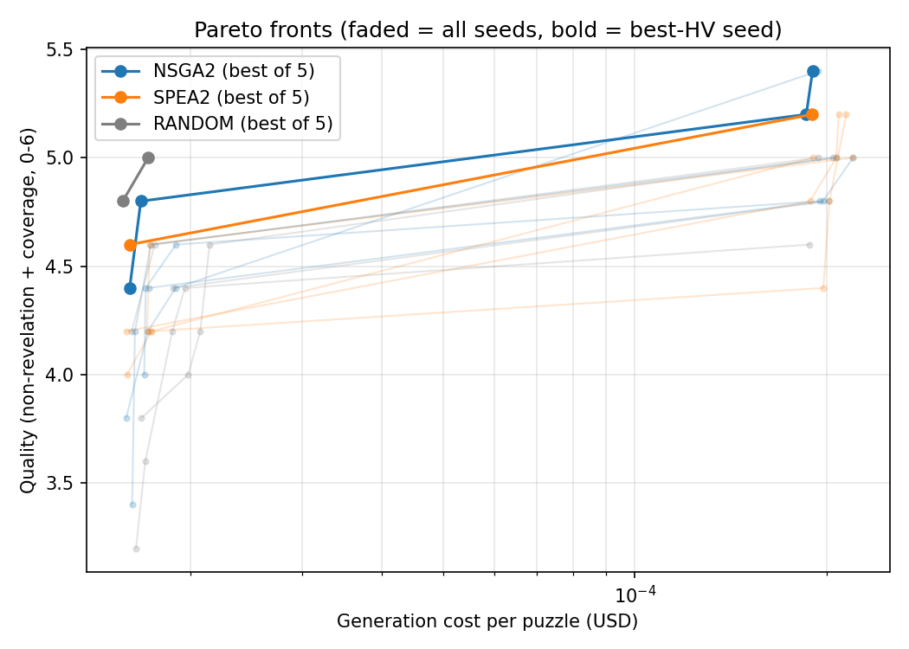

# MONRP x SlowSoup — Clue Generation Pipeline

A multi-objective optimization study of LLM-based clue generation for lateral-thinking puzzles, derived from the SlowSoup platform.

---

## Key findings

From 750 configuration evaluations (3 algorithms × 5 seeds × 10 population × 5 generations), all scored on the same 5 puzzles:

- **A small model reaches ~93% of the best quality at ~1/11 of the cost.** The best `llama-3.1-8b-instant` config scored 5.0 / 6. The highest-quality config found (`llama-3.3-70b-versatile`) scored 5.4 / 6 and cost 11× more to generate.

  | | Model | Template | Clues | Temp | Quality (0–6) | Generation cost / puzzle | Found by |
  |---|---|---|---|---|---|---|---|
  | Best 8B config | `llama-3.1-8b-instant` | decomposed | 4 | 0.65 | 5.0 | $0.0000171 | Random, seed 5 |
  | Top-quality config | `llama-3.3-70b-versatile` | decomposed | 3 | 0.61 | 5.4 | $0.000190 | NSGA-II, seed 4 |

- **NSGA-II and SPEA2 did not significantly beat random search.** On final hypervolume, NSGA-II leans ahead of Random (Vargha-Delaney A12 = 0.68, a medium effect), but the difference is not significant (Mann-Whitney p = 0.42). SPEA2 vs Random gives p = 0.69 (A12 = 0.60) and NSGA-II vs SPEA2 gives p = 0.84. The three median HVs are within 0.4% of each other. With 5 seeds and 50 evaluations per run, this study cannot separate the algorithms. Full numbers are in [`results/stats.md`](results/stats.md).
- **Every config on the combined Pareto front uses the `decomposed` template**, with 3–4 clues.



*Caveats:* quality is the mean over 5 puzzles with a single grader run each, so the 0.4-point gap amounts to 2 rubric points summed across those 5 puzzles. Cost covers Groq generation only; Claude grading cost is not included.

---

## Dataset

This project uses the lateral-thinking-puzzle dataset from **_Weak-eval-Strong: Evaluating and Eliciting Lateral Thinking of LLMs with Situation Puzzles_** (Chen et al., NeurIPS 2024). The dataset is **not redistributed in this repository** — please obtain `puzzles.xlsx` from the [official paper repository](https://github.com/chenqi008/LateralThinking) and place it at the project root before running. For more information, see the [Citation](#citation) section below.

---

## Setup

Requires Python 3.10+.

```bash
pip install -r requirements.txt
cp .env.example .env
# fill in GROQ_API_KEY and ANTHROPIC_API_KEY in .env
# place puzzles.xlsx at the repo root (see Dataset section above)
```

---

## Running the search

The pipeline has two entry points, both runnable as Python modules from the repo root:

```bash
python -m algos.run      # 1. run the optimization sweep
python -m algos.plot     # 2. build plots + stats from the saved JSONs
```

### What `algos.run` does

For every `(algorithm, seed)` pair in the configured grid, it:

1. Samples `PUZZLES` puzzles using `PUZZLE_SEED` so every run faces the same problems.
2. Evolves a population of `POP` candidates for `GENS` generations. The `random` baseline uses the same `POP × GENS` evaluation budget.
3. For every candidate, calls `evaluate_config()` in [`clue_pipeline/runner.py`](clue_pipeline/runner.py) which:
   - generates clues via Groq (one parallel thread per puzzle in the sample),
   - grades them via Claude (`claude-sonnet-4-6`) at `temperature = 0`, `GRADER_RUNS` times per puzzle,
   - aggregates mean cost and mean quality across the `PUZZLES` sampled puzzles,
   - caches the result by SHA-256 of `(config + puzzle indices)` under `cache/evaluations/` (created on first run; gitignored), so repeated configs are free.
4. Writes a per-seed checkpoint to `results/{algo}_seed{NN}.json` containing the per-generation objective values (`history`) and the final non-dominated front. For NSGA-II/SPEA2, `history` holds the surviving population after each generation; for Random it holds every sampled config.

The sweep is **resumable**: if `results/{algo}_seed{NN}.json` already exists it is skipped. Interrupt with Ctrl-C and rerun `python -m algos.run` to pick up where it stopped. Delete a specific JSON to redo just that run. The evaluation cache survives independently of `results/`, so even forced re-runs of completed seeds cost nothing in API calls as long as the configs repeat.

### What `algos.plot` does

Loads every `{algo}_seed*.json` under `results/`, computes a shared hypervolume reference point (see [Experimental protocol](#experimental-protocol)), then writes [`results/pareto.png`](results/pareto.png), [`results/convergence.png`](results/convergence.png), [`results/hv_boxplot.png`](results/hv_boxplot.png), and [`results/stats.md`](results/stats.md). The contents of `stats.md` are also echoed to stdout.

---

## Configuring the search

All knobs live in two files. Edit them, then re-run `python -m algos.run`.

### Sweep settings — [`algos/run.py`](algos/run.py) (top of file)

| Name | Default | Effect |
|---|---|---|
| `ALGOS` | `["nsga2", "spea2", "random"]` | Which optimizers to run. Drop entries to skip them. |
| `SEEDS` | `list(range(1, 6))` | Independent repeats per algorithm. More seeds → stronger statistics, linearly more API spend. |
| `POP` | `10` | Population size per generation. |
| `GENS` | `5` | Number of generations. Evaluation budget per seed = `POP * GENS`. |
| `PUZZLES` | `5` | Puzzles drawn from the dataset for **every** evaluation. Larger → less noisy mean, linearly more API spend. |
| `PUZZLE_SEED` | `42` | Seed for the puzzle sample. Keep fixed across an experiment so all configs face the same problems. |
| `GRADER_RUNS` | `1` | Times Claude grades each clue set. See [Limitations](#limitations--future-works). |

### Decision-variable bounds — [`algos/problem.py`](algos/problem.py)

`ClueGenProblem.__init__` exposes:

- `n_clues_bounds=(3, 8)` — integer range for the clue-count gene.
- `temperature_bounds=(0.0, 1.0)` — continuous range for the Groq sampling temperature.

The categorical choices (`model`, `template`) are taken from `MODELS` and `PROMPT_TEMPLATES` in [`clue_pipeline/generator.py`](clue_pipeline/generator.py); add or remove entries there to expand or shrink the categorical search space.

The Random baseline (`run_random` in [`algos/run.py`](algos/run.py)) samples from the same `ClueGenProblem` variables, so any change here applies to all three algorithms.

### API keys

`GROQ_API_KEY` and `ANTHROPIC_API_KEY` are read from `.env` via [`clue_pipeline/config.py`](clue_pipeline/config.py).

---

## Decision Variables

| Variable | Type | Values |
|---|---|---|
| Groq model | categorical | `llama-3.1-8b-instant`, `openai/gpt-oss-20b`, `openai/gpt-oss-120b`, `llama-3.3-70b-versatile` |
| Prompt template / decomposition strategy | categorical | `direct`, `decomposed` |
| Number of clues | integer | 3–8 |
| Temperature | continuous | 0.0–1.0 |

---

## Objectives

Each config is evaluated on a fixed sample of 5 puzzles (`PUZZLES`, drawn with `PUZZLE_SEED`). The two objectives are the **mean across that sample**:

- **Minimize cost**: mean Groq generation cost per puzzle (USD), computed from token usage × the per-model prices in [`clue_pipeline/generator.py`](clue_pipeline/generator.py). Claude grading cost is not counted.
- **Maximize quality**: mean rubric score from Claude (sum of the two sub-scores below, 0–6):
  - Non-revelation (0-3)
    - 3: No single clue reveals the core twist
    - 2: One clue is borderline but still requires inference
    - 1: One clue largely gives it away
    - 0: Multiple clues directly state the answer
  - Coverage (0-3)
    - 3: All key elements of the reference solution are pointed to
    - 2: Most key elements covered, minor gaps
    - 1: Significant elements missing
    - 0: Clues miss the core of the solution

---

## Stack

| Component | Tool |
|---|---|
| Clue generation | Groq API |
| Quality scoring | Claude API (`claude-sonnet-4-6`, rubric-based, `temperature = 0`) |
| Optimization | NSGA-II / SPEA2 |
| Baseline | Uniform Random Search (same eval budget) |
| Puzzles + reference solutions | Chen et al. (2024) dataset |

---

## Experimental protocol

Because metaheuristic search is stochastic, a single run is not a reliable signal. The pipeline runs each algorithm — **NSGA-II**, **SPEA2**, and **Random Search** — across **5 independent seeds** (`SEEDS`) on a fixed puzzle sample (`PUZZLE_SEED = 42`). Each `(algorithm, seed)` run uses the same `POP × GENS` = 10 × 5 = 50-evaluation budget so the comparison is apples-to-apples, for 750 evaluations in total.

Random Search draws configurations uniformly from the same decision-variable space defined in [`algos/problem.py`](algos/problem.py) and returns its non-dominated front over all evaluated points.

For each run we compute the **2-D hypervolume** of the final non-dominated front against a shared reference point. On the cost axis it sits at 1.05 × the highest generation cost observed across all runs; failed evaluations are excluded. On the quality axis it sits at 0, the rubric's worst possible score. This yields 5 HV samples per algorithm.

We then run a **pairwise two-sided Mann-Whitney U test** on the HV samples for each algorithm pair (NSGA-II vs Random, SPEA2 vs Random, NSGA-II vs SPEA2), and report the **Vargha-Delaney A12** effect size alongside it. Results are written to [`results/stats.md`](results/stats.md).

---

## Viewing output & logs

### Live console output (during `algos.run`)

Each evaluation prints one line. Two formats appear:

```
[eval] llama-3.1-8b-instant/direct/n=4/T=0.72 -> cost=$0.00012 q=4.40
[eval failed] llama-3.3-70b-versatile/decomposed/n=7/T=0.15 -> JSONDecodeError: ...
```

A failed evaluation is recorded as `F = [1.0, 0.0]` (very bad cost + worst quality) so the optimizer learns to avoid it, but the sweep does **not** abort. NSGA-II/SPEA2 runs also print pymoo's per-generation progress table. Per-seed bookkeeping lines bracket each run:

```
=== nsga2 seed=1 ===
... eval lines ...
saved -> results/nsga2_seed01.json
```

Already-finished seeds report:

```
[skip] nsga2_seed01.json already exists
```

To capture the full log to a file:

```powershell
python -m algos.run 2>&1 | Tee-Object -FilePath results\run.log    # Windows PowerShell
```

```bash
python -m algos.run 2>&1 | tee results/run.log                      # macOS/Linux
```

### Per-seed checkpoints

Each completed run produces `results/{algo}_seed{NN}.json`:

```json
{
  "algo": "nsga2",
  "seed": 1,
  "pop": 10,
  "gens": 5,
  "puzzles": [199, 789, 174, 467, 66],
  "puzzle_seed": 42,
  "history": [[[cost, -quality], ...], ...],
  "front": [{"config": {...}, "cost": ..., "quality": ...}, ...]
}
```

Inspect a single front quickly:

```bash
python -c "import json; print(json.dumps(json.load(open('results/nsga2_seed01.json'))['front'], indent=2))"
```

### Plots & stats (from `algos.plot`)

- [`results/pareto.png`](results/pareto.png) — Pareto fronts per algorithm (faded = each seed, bold = best-HV seed).
- [`results/convergence.png`](results/convergence.png) — median cumulative HV with IQR band over generations.
- [`results/hv_boxplot.png`](results/hv_boxplot.png) — final-HV distribution across seeds.
- [`results/stats.md`](results/stats.md) — per-algorithm summary table + pairwise Mann-Whitney U and Vargha-Delaney A12.

### Evaluation cache

Per-config evaluations are cached under `cache/evaluations/` (gitignored, so a fresh clone starts with an empty cache) as JSON, keyed by a 16-char SHA-256 prefix of `(config + puzzle_indices)`. Each cache file is a full `ConfigEval` including every per-puzzle clue list, rubric score, and cost — useful for post-hoc inspection of what a specific config actually produced. Delete the directory to force a full re-evaluation; delete a single file to invalidate just that config.

---

## Limitations & Future Works
* Number of Clues
  * Our current approach searches based on a hardcoded "Number of Clues", whereas in reality, a better approach might be to either let the model decide the exact number or adjust the limit based on puzzle difficulty.
* Grading: 1-run vs. 3-run averaged
  * Our intuition was to take the average of the quality scores across 3 runs, but after experimenting with the dataset, we found that the deviation between individual grading runs is quite minimal given that Claude is set to temperature = 0. 
  * Thus, we went with 1 run instead of 3 to save tokens, though ideally the 3-run average approach would be more bulletproof and better justified despite the minimal difference in effect.

---
## Citation

```bibtex
@inproceedings{chen2024weak,
  title={Weak-eval-Strong: Evaluating and Eliciting Lateral Thinking of LLMs with Situation Puzzles},
  author={Chen, Qi and Zhang, Bowen and Wang, Gang and Wu, Qi},
  booktitle={Advances in Neural Information Processing Systems (NeurIPS)},
  year={2024}
}
```